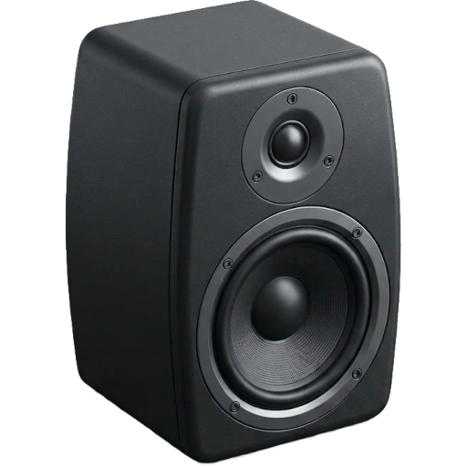
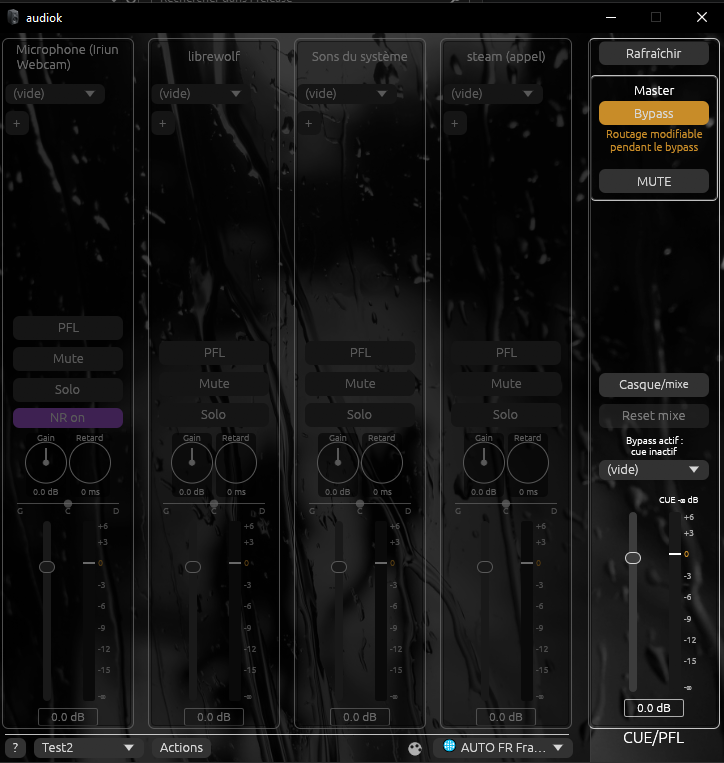
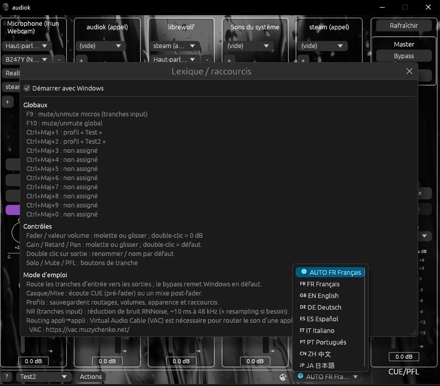
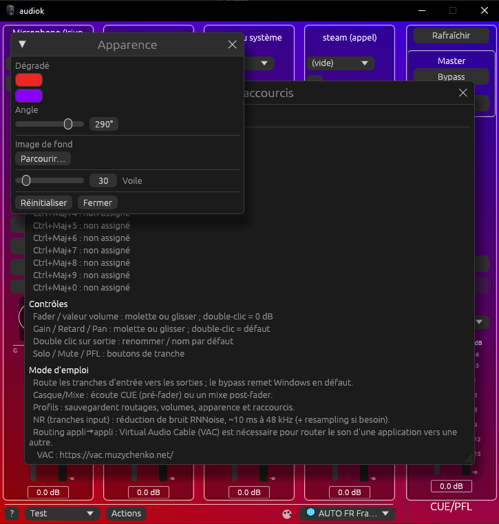

# audiok

Gestionnaire audio pour Windows 10/11 écrit en Rust. `audiok` capture les micros et les applications actives, puis répartit chaque source vers une ou plusieurs sorties (matériel ou application), avec fader, mute/solo, écoute CUE et profils.



## Fonctionnement

- Une tranche par entrée détectée : périphérique matériel ou session d'application.
- Chaque tranche possède plusieurs sélecteurs de sortie, dont un vide. Une sortie supplémentaire apparaît quand une deuxième sortie est choisie.
- Réglages par tranche : volume (`-24…+24 dB`), trim/gain, retard `0…5000 ms`, panoramique `G`/`D`, réduction de bruit RNNoise pour les micros, mute, solo et PFL.
- Panneau master à droite : bypass, mutes (micros, entrées, sorties, global), volume et vumètre, bus CUE/PFL avec modes **Casque** (pré-fader) et **Mixe** (post-fader).
- Le **bypass** restaure les sorties Windows par défaut : `audiok` ne redirige plus rien.
- Les profils mémorisent les routages, volumes, apparences et raccourcis. La configuration est sauvegardée automatiquement après 2 secondes d'inactivité.
- Langues : français, anglais, allemand, espagnol, italien, portugais, chinois, japonais, plus le choix `Auto` basé sur la langue système.
- Icône dans la zone de notification : clic gauche pour afficher/masquer la fenêtre, menu pour quitter ou activer le démarrage avec Windows.

## Captures d'écran





## Lancer l'application

Téléchargez l'exécutable x64 `audiok_<version>_win_x64.exe` (par exemple `audiok_0.1.0_win_x64.exe`) depuis l'onglet **Releases** et lancez-le directement : aucune installation, aucun VS Code, aucun terminal et aucune fenêtre console ne sont nécessaires.

- `audiok_<version>_win_x64.exe --tray` : démarre masqué dans la zone de notification (paramètre utilisé par « Démarrer avec Windows »).
- Pour quitter proprement, utilisez le menu de l'icône systray : les redirections et les défauts Windows sont alors restaurés.

Le code n'effectue aucun appel réseau.

## Son d'application à application

Pour router le son d'une application vers une autre, `audiok` utilise **Virtual Audio Cable (VAC)** de Muzychenko : https://vac.muzychenko.net/

Prérequis :

1. Installer le pilote VAC (commercial, licence à acquérir séparément).
2. Configurer **au moins 2 câbles** : le câble au numéro le plus haut est réservé comme « puits » pour les applications non routées ; les autres servent au retour vers les applications de destination.
3. Dans `audiok`, désactiver le **bypass**, puis choisir l'application de destination dans un sélecteur de sortie de la tranche voulue.
4. Dans l'application réceptrice (Discord, TeamSpeak, etc.), sélectionner l'entrée **Par défaut** / **Default** correspondant au câble attribué. Si elle ne réagit pas, la redémarrer.

Limites connues :

- Le réglage du périphérique d'une application passe par `IAudioPolicyConfigFactory`, une API Windows non documentée et dépendante de la version (Win10 et 21H2+ n'utilisent pas les mêmes identifiants).
- Une application avec son propre sélecteur de périphérique ou un rebind asynchrone peut ignorer le défaut posé par `audiok`.
- Les sessions n'apparaissent que si l'application émet du audio au moment du rafraîchissement ; « Sons du système » (PID 0) n'est pas capturable.
- Changer le nombre de câbles VAC redémarre le pilote : le faire hors utilisation et avec les droits administrateur.

## Raccourcis

- `F9` : mute/unmute des micros (tranches `input:`).
- `F10` : mute/unmute global.
- `Ctrl+Maj+1` … `Ctrl+Maj+9` et `Ctrl+Maj+0` : profils assignés (10 slots).
- Fader/volume : molette ou glisser ; double-clic pour revenir à 0 dB.
- Gain/retard/pan : molette ou glisser ; double-clic pour revenir à la valeur par défaut.
- Double-clic sur un sélecteur de sortie : renommer ou revenir au nom automatique.

Les raccourcis globaux sont actifs tant qu'`audiok` tourne. En cas de conflit avec une autre application, l'enregistrement échoue silencieusement et un message est écrit dans le journal.

## Données et diagnostics

- Configuration : `%LOCALAPPDATA%\audiok\config.json`
- Images de fond importées : `%LOCALAPPDATA%\audiok\backgrounds\`
- Journal courant : `%LOCALAPPDATA%\audiok\audiok.log`
- Journal précédent : `%LOCALAPPDATA%\audiok\audiok.previous.log` (rotation à 2 Mo)

## Compiler depuis les sources

Prérequis : Rust stable (voir `rust-toolchain.toml`) et le toolchain Windows MSVC.

Depuis l'invite de commande Windows :

```bat
build_release.cmd
```

Depuis Git Bash :

```bash
cmd //c build_release.cmd
```

`build_release.cmd` remplace `cargo build --release` : il compile puis copie l'exécutable en `target\release\audiok_<version>_win_x64.exe`, la version étant lue dans `Cargo.toml` (même source que `CARGO_PKG_VERSION`). `target\release\audiok.exe` reste généré. L'attribut `windows_subsystem = "windows"` supprime la console ; les messages restent disponibles dans le fichier de journal.

Vérifications :

```bash
cargo fmt --check
cargo clippy
cargo test
```
